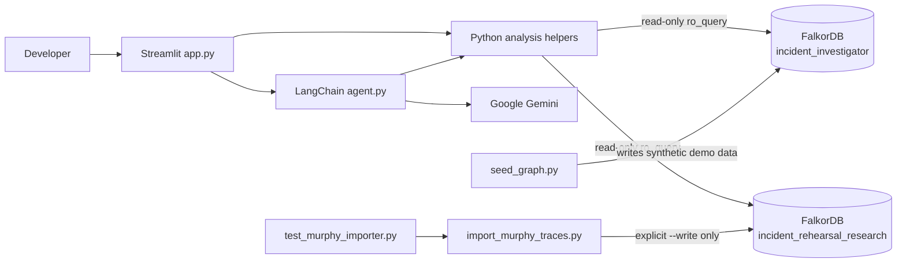
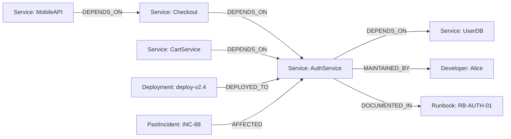
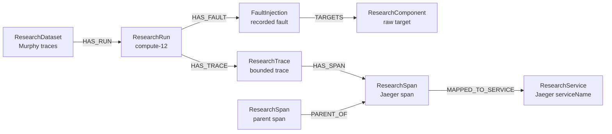

# Incident Rehearsal

> **Explainable graph investigation for service incidents and bounded research
> fault evidence.**

Incident Rehearsal helps a developer answer a practical incident question:
**which services are structurally exposed, what evidence is recorded around
the selected service or fault, and what remains unknown?**

The application uses FalkorDB graph traversal rather than a static list of
services. It has two intentionally separate workflows:

1. **Incident Rehearsal** explores a small synthetic service graph, measures
   dependency blast radius, and compares hypothetical dependency removal in
   memory.
2. **Murphy Research** investigates a bounded sample of experimental
   DeathStarBench traces with injected faults.

The research workflow is not live production telemetry, and the synthetic
records are not real operational data.

This project was built for the [Graph Hacks: Context for AI
Agents](https://github.com/falkordb/graph-hacks) hackathon. The repository and
documentation were prepared with assistance from an AI coding assistant. The
implementation and setup notes should be reviewed against the source and
environment before production use.

## Features

### Synthetic incident investigation

- Overview of service health, dependency relationships, and focus-service
  metrics.
- Read-only FalkorDB queries for impacted services, direct dependencies,
  deployments, historical incidents, owners, and runbooks.
- Bounded dependency traversal and structural blast-radius measurements.
- A deterministic **Incident Rehearsal** workflow that compares reachability
  before and after removing one actual incoming dependency edge from an
  in-memory copy.
- Automatic comparison of all candidate incoming edges, ranked by lost
  reachability.
- Evidence-grounded Gemini/LangChain investigation reports with a deterministic
  graph-tool fallback when Gemini quota exhaustion is detected.

### Murphy research investigation

- Recorded-fault selector backed by the isolated
  `incident_rehearsal_research` graph.
- Exact overlap analysis for the selected fault interval using stored Jaeger
  timestamps.
- Counts of overlapping traces and spans, service/operation breakdown, trace
  IDs, span IDs, source files, and explicit parent-child evidence.
- A Graphviz trace-topology view derived only from recorded service mappings
  and explicit parent-child span relationships.
- Honest handling of unresolved target identities, missing parent spans, and
  unknown timestamps.
- Clear separation of measured evidence, possible relevance, and unknown
  information.

### Visualization boundaries

The application uses rendered Graphviz diagrams. They are not clickable node
canvases. In the synthetic workflow, select or focus a service through the
Streamlit controls; the graph, metrics, and evidence update for that focus.
The Murphy topology is a separate rendered view and does not invent edges when
the bounded research sample cannot justify them.

## The two datasets

The graphs are separate by design. The application does not merge their
schemas or treat research observations as operational facts.

### Synthetic demonstration graph

**Graph:** `incident_investigator`

The graph contains five fictional services:

- `MobileAPI`
- `Checkout`
- `CartService`
- `AuthService`
- `UserDB`

It also contains synthetic health states, dependency edges, and
`AuthService` evidence for a developer, deployment, historical incident, and
runbook. This graph demonstrates dependency direction, blast-radius
calculation, and hypothetical scenarios. It is not production telemetry.

The seeded dependency relationships are:

```text
MobileAPI  -> Checkout
Checkout   -> AuthService
CartService -> AuthService
AuthService -> UserDB
```

Here `A -> B` means **A depends on B**. Therefore, when `AuthService` is the
focus, `Checkout`, `CartService`, and `MobileAPI` are reached by following
incoming dependency paths toward `AuthService`.

### Murphy research graph

**Graph:** `incident_rehearsal_research`

The pilot is based on the [Murphy traces dataset at the University of Illinois
Data Bank](https://databank.illinois.edu/datasets/IDB-6641912).

- DOI: `10.13012/B2IDB-6641912_V1`
- Dataset license: CC0, as stated by the dataset record.
- Benchmark: DeathStarBench `hotel-reserv`.
- Fault families in the source data include experimentally injected compute,
  memory, and disk faults.

The current bounded pilot imported:

| Record | Count |
|---|---:|
| Research datasets | 1 |
| Research runs | 1 |
| Fault records | 6 |
| Unique research components | 4 |
| Research traces | 5 |
| Research spans | 55 |

Read-only verification of the current graph also found six recorded research
services and 17 stored parent-child relationships. The pilot deliberately did
**not** import Prometheus metrics or `wrkOutput`. The application therefore
does not currently detect CPU or memory anomalies from those unimported
metrics, and it does not claim production impact.

## Architecture



### Components

- [`app.py`](./app.py) is the Streamlit entry point. It renders Overview,
  Incident Rehearsal, Murphy Research, and Investigation Report sections.
- [`tools.py`](./tools.py) owns the shared lazy FalkorDB connection, read-only
  Cypher helpers, LangChain tools, Murphy evidence retrieval, and exact
  selected-fault analysis.
- [`agent.py`](./agent.py) creates the Gemini LangChain agent for the synthetic
  incident workflow. It instructs the model to distinguish graph facts,
  reporter observations, hypotheses, and unknowns.
- [`import_murphy_traces.py`](./import_murphy_traces.py) parses a bounded
  archive sample. It defaults to dry-run mode and writes only with an explicit
  `--write`.
- [`seed_graph.py`](./seed_graph.py) creates or updates the fictional
  `incident_investigator` demo graph. It must not be used to populate the
  Murphy research graph.
- [`test_murphy_importer.py`](./test_murphy_importer.py) contains focused tests
  for parsing, timestamp overlap, topology evidence, importer bounds, and the
  production-graph safety guard.

Gemini is used only by the synthetic incident report workflow. Murphy
investigation is deterministic and graph-backed; it does not require an LLM
call.

## Graph schemas and important queries

### Synthetic graph schema

| Label | Important properties |
|---|---|
| `Service` | `id`, `name`, `status` |
| `Developer` | `id`, `name`, `email`, `on_call` |
| `Deployment` | `id`, `version`, `commit_hash`, `timestamp`, `description` |
| `PastIncident` | `id`, `title`, `root_cause`, `resolution` |
| `Runbook` | `id`, `title`, `url` |

| Relationship | Direction and meaning |
|---|---|
| `DEPENDS_ON` | `Service -> Service`; the source depends on the target |
| `MAINTAINED_BY` | `Service -> Developer` |
| `DEPLOYED_TO` | `Deployment -> Service` |
| `AFFECTED` | `PastIncident -> Service` |
| `DOCUMENTED_IN` | `Service -> Runbook` |

### Synthetic graph: the demo service topology

This is the actual seeded `incident_investigator` graph model. The arrows
retain the direction written by `seed_graph.py`: a service points to the
service it depends on.



The service nodes and relationship types above are the graph used by the
synthetic Overview and Incident Rehearsal workflows. The Graphviz view in the
application is a rendered view of graph records; it is not a clickable
FalkorDB browser.

### Research graph schema

The importer creates isolated research labels and relationships:

| Label | Purpose |
|---|---|
| `ResearchDataset` | Dataset metadata and DOI |
| `ResearchRun` | Bounded archive/run metadata |
| `FaultInjection` | Fault interval, target, category, and phase |
| `ResearchComponent` | Recorded fault target component |
| `ResearchTrace` | Bounded trace record |
| `ResearchSpan` | Jaeger span and provenance fields |
| `ResearchService` | Service identity recorded by Jaeger mappings |

| Relationship | Meaning |
|---|---|
| `HAS_RUN` | Dataset -> research run |
| `HAS_FAULT` | Run -> fault |
| `TARGETS` | Fault -> target component |
| `HAS_TRACE` | Run -> trace |
| `HAS_SPAN` | Trace -> span |
| `PARENT_OF` | Parent span -> child span |
| `MAPPED_TO_SERVICE` | Span -> recorded research service |

### Murphy research graph: the evidence model

This is the isolated `incident_rehearsal_research` model written by
`import_murphy_traces.py`. It deliberately does not connect to the synthetic
`Service` graph.



`ResearchComponent` preserves the raw fault target identity. The importer
does not create a `ResearchComponent -> ResearchService` mapping, so a target
is not silently converted into a service name. The displayed parent and child
span nodes are both `ResearchSpan` nodes; the diagram shows their exact stored
relationship.

The research topology rendered by the application is narrower than the full
schema diagram: it draws a service-to-service arrow only when an explicit
`PARENT_OF` span relationship exists and both spans have recorded
`MAPPED_TO_SERVICE` relationships. It suppresses self-loops and duplicate
edges. Missing mappings remain unresolved rather than becoming invented
relationships.

### Representative Cypher

The application binds user-selected values as parameters and uses
`graph.ro_query(...)` for investigation reads.

**Service blast radius / impacted paths:**

```cypher
MATCH p = (dependent:Service)-[:DEPENDS_ON*1..5]->(target:Service)
WHERE target.name = $service_name
RETURN p, length(p) AS hops
ORDER BY hops, dependent.name
```

The deterministic blast-radius helper uses the same incoming dependency
direction with a three-hop bound, records each service once at its shortest
distance, and counts direct versus indirect dependents.

**Direct service dependencies:**

```cypher
MATCH p = (service:Service)-[:DEPENDS_ON]->(dependency:Service)
WHERE service.name = $service_name
RETURN p, service.name, dependency.name, dependency.status
```

**Research fault lookup and target mapping:**

```cypher
MATCH (run:ResearchRun)-[:HAS_FAULT]->(fault:FaultInjection)
WHERE fault.id = $fault_id
OPTIONAL MATCH (fault)-[:TARGETS]->(target:ResearchComponent)
OPTIONAL MATCH (target)-[:MAPPED_TO_SERVICE]->(target_service:ResearchService)
RETURN run.id, fault.id, fault.start_time, fault.end_time,
       fault.target_entity, target.id, target_service.name
```

**Research trace/span evidence and explicit parent evidence:**

```cypher
MATCH (run:ResearchRun)-[:HAS_FAULT]->(fault:FaultInjection)
MATCH (run)-[:HAS_TRACE]->(trace:ResearchTrace)-[:HAS_SPAN]->(span:ResearchSpan)
WHERE fault.id = $fault_id
OPTIONAL MATCH (span)-[:MAPPED_TO_SERVICE]->(service:ResearchService)
OPTIONAL MATCH (parent:ResearchSpan)-[:PARENT_OF]->(span)
OPTIONAL MATCH (parent)-[:MAPPED_TO_SERVICE]->(parent_service:ResearchService)
RETURN trace.id, span.id, span.parent_span_id,
       parent.original_span_id, parent_service.name, service.name,
       span.start_time_microseconds, span.duration_microseconds,
       span.source_file
```

FalkorDB is central because the investigation follows relationships rather
than merely displaying static rows:

- For the synthetic blast radius, the query follows incoming
  `DEPENDS_ON` paths from dependent services to the selected target:

  ```cypher
  MATCH p = (dependent:Service)-[:DEPENDS_ON*1..5]->(target:Service)
  WHERE target.name = $service_name
  RETURN p, length(p) AS hops
  ```

  The application then counts unique dependent services and their shortest
  path distances. A path indicates potential structural exposure, not a
  confirmed outage or causal chain.
- For Murphy investigation, the query starts at a selected
  `FaultInjection`, follows `HAS_TRACE` and `HAS_SPAN`, and optionally follows
  `PARENT_OF` and `MAPPED_TO_SERVICE` to retrieve linked trace/span evidence.
  Python compares the exact selected fault interval with preserved Jaeger
  microsecond intervals. Temporal overlap is a measured time relationship, not
  proof that the fault caused the span behavior.

The complete relationship set used by the investigation includes:
dependent-service paths, deployment-to-service evidence, fault-to-component
links, trace/span membership, service mappings, and parent-child spans. A
flat table could display the same fields, but it would not provide the
relationship-constrained traversal that prevents unsupported topology claims.

## Installation and configuration

The following commands are for Windows PowerShell.

### 1. Clone and create a virtual environment

```powershell
git clone https://github.com/prithvi-yadav/Incident-Rehearsal-Explainable-AI-Blast-Radius-Investigator.git
Set-Location .\Incident-Rehearsal-Explainable-AI-Blast-Radius-Investigator
py -3.13 -m venv venv
.\venv\Scripts\Activate.ps1
```

If activation is blocked by local PowerShell policy, invoke
`.\venv\Scripts\python.exe` directly instead.

### 2. Install the pinned dependencies

```powershell
python -m pip install --upgrade pip
python -m pip install -r .\requirements.txt
```

The current manifest pins FalkorDB `1.7.1`, Streamlit `1.66.0`, LangChain
`1.4.4`, LangChain Core `1.6.9`, LangChain Google GenAI `4.4.1`,
`google-genai` `2.29.0`, and the supporting packages.

### 3. Configure local environment variables

Copy the tracked template and edit the private local file:

```powershell
Copy-Item .\.env.example .\.env
```

The application and importer load `.env` through `python-dotenv`. `.env` is
ignored by Git and must never contain a value that is copied into public
documentation or committed.

#### FalkorDB settings

`tools.py`, `seed_graph.py`, and `import_murphy_traces.py` support these
settings:

| Variable | Purpose |
|---|---|
| `FALKORDB_URL` | Optional `falkor://` or `falkors://` connection URL |
| `FALKORDB_HOST` | Host fallback; defaults to `localhost` |
| `FALKORDB_PORT` | Port fallback; defaults to `6379` |
| `FALKORDB_GRAPH_NAME` | Synthetic graph selected by the app; defaults to `incident_investigator` |
| `FALKORDB_USERNAME` | Optional database username |
| `FALKORDB_PASSWORD` | Optional database password |
| `FALKORDB_SSL` | Enables TLS for explicit host/port configuration |
| `FALKORDB_SSL_CERT_REQS` | TLS certificate requirement |
| `FALKORDB_SSL_CA_CERTS`, `FALKORDB_SSL_CA_PATH`, `FALKORDB_SSL_CA_DATA` | Optional CA configuration |
| `FALKORDB_SSL_CERTFILE`, `FALKORDB_SSL_KEYFILE`, `FALKORDB_SSL_PASSWORD` | Optional client certificate configuration |
| `FALKORDB_SSL_CHECK_HOSTNAME` | Enables TLS hostname checking |
| `FALKORDB_SSL_VALIDATE_OCSP` | Enables OCSP validation when supported |
| `FALKORDB_SSL_VALIDATE_OCSP_STAPLED` | Enables stapled OCSP validation when supported |
| `FALKORDB_SSL_OCSP_EXPECTED_CERT` | Optional expected OCSP certificate |

The research helpers always select `incident_rehearsal_research` explicitly;
changing `FALKORDB_GRAPH_NAME` does not merge the research graph into the
synthetic graph.

For hosted FalkorDB, use the provider's documented TLS/connection settings.
Some free hosted plans may restrict TLS or certificate options; do not assume
that setting `FALKORDB_SSL=true` can overcome a provider-side limitation.
Never publish a connection URL containing credentials.

#### Gemini settings

`agent.py` checks these names, in order:

```text
GEMINI_API_KEY
GOOGLE_API_KEY
```

The same names may be provided through Streamlit Community Cloud secrets.
Gemini is needed for the LLM-generated synthetic incident report; the
deterministic graph evidence and Murphy analysis do not require a Gemini call.

### 4. Start FalkorDB locally

If FalkorDB is not already running locally, a typical Docker command is:

```powershell
docker run --name falkordb `
  -p 6379:6379 `
  -p 3000:3000 `
  -d falkordb/falkordb:latest
```

If the container already exists:

```powershell
docker start falkordb
```

These commands are setup examples; they were not executed as part of this
README-only update.

## Running the application

### Seed the synthetic demonstration graph

Run this only when you intentionally want to create or update the fictional
service graph:

```powershell
python .\seed_graph.py
```

This script writes to the graph selected by `FALKORDB_GRAPH_NAME`, which should
remain `incident_investigator` for the synthetic demo. **Do not use it for the
Murphy research graph.**

### Start Streamlit

```powershell
python -m streamlit run .\app.py
```

The app presents four top-level sections:

1. **Overview** — describe an incident, focus a service, inspect health,
   topology, and structural blast-radius metrics, then start the synthetic
   investigation.
2. **Incident Rehearsal** — select the baseline or an actual incoming
   dependency edge, compare before/after reachability, and rank all candidate
   scenarios. Edge removal is in memory only.
3. **Murphy Research** — load recorded faults, select **Investigate fault**,
   review exact overlap counts, topology, service/operation evidence,
   provenance, parent-child paths, and evidence boundaries.
4. **Investigation Report** — read or download the Markdown report generated by
   the synthetic incident workflow.

### Beginner workflow: synthetic incident

1. Open **Overview** and keep the example incident or describe an observed
   symptom.
2. Confirm the **Focus service**. A service mentioned in the description may be
   selected automatically.
3. Read the dependency direction and blast-radius cards.
4. Select **Investigate Incident** and review the graph-backed report.
5. Open **Incident Rehearsal**, choose an incoming edge, and compare the
   before/after structural reachability.
6. Treat deployment, incident, owner, and runbook records as investigation
   clues, not proof of cause or safe remediation.

### Beginner workflow: Murphy recorded fault

1. Open **Murphy Research**.
2. Load the recorded fault list and select one fault.
3. Click **Investigate fault**.
4. Review the selected interval, exact overlapping trace/span counts, source
   filenames, service/operation breakdown, and explicit parent-child paths.
5. Use the topology legend to distinguish overlap highlighting, validated
   target mappings, and unresolved targets.
6. Separate measured observations from inferences. Temporal overlap alone does
   not prove causality.

## Murphy dataset setup and importer

The official source is the [Murphy traces dataset at the University of Illinois
Data Bank](https://databank.illinois.edu/datasets/IDB-6641912). Cite it as:

```text
University of Illinois Data Bank, Murphy traces dataset,
DOI: 10.13012/B2IDB-6641912_V1, CC0.
```

The importer reads one local archive and selects a bounded set of relevant
traces and spans. It does not download the dataset or load the full archive
into memory.

### Supported command-line arguments

`import_murphy_traces.py` supports:

| Argument | Required/default | Meaning |
|---|---|---|
| `--archive PATH` | Required | Local `.tar.gz` archive to inspect |
| `--graph-name NAME` | `incident_rehearsal_research` | Must be the isolated research graph |
| `--max-traces N` | `5` | Maximum selected traces |
| `--max-spans N` | `100` | Maximum selected spans |
| `--write` | Off | Explicitly enable FalkorDB writes |

Use a local path appropriate to your machine. This example is not a universal
path:

```powershell
python .\import_murphy_traces.py `
  --archive D:\MurphyResearch\pilot\compute-faults\compute-12.tar.gz `
  --max-traces 5 `
  --max-spans 100
```

Dry-run mode is the default and prints parsed counts without writing. A write
requires the explicit flag and is restricted to
`incident_rehearsal_research`:

```powershell
python .\import_murphy_traces.py `
  --archive D:\MurphyResearch\pilot\compute-faults\compute-12.tar.gz `
  --max-traces 5 `
  --max-spans 100 `
  --graph-name incident_rehearsal_research `
  --write
```

The importer rejects both `incident_investigator` and any other graph name.
Do not run the write command unless you have reviewed the archive, target
graph, credentials, and resulting records. The importer does not import
Prometheus metrics in this pilot.

To verify the separate research graph with read-only queries, use FalkorDB's
browser/CLI or a small `ro_query` script. For example:

```cypher
MATCH (n:FaultInjection)
RETURN count(n) AS faults;

MATCH (n:ResearchSpan)
RETURN count(n) AS spans;

MATCH ()-[r:PARENT_OF]->()
RETURN count(r) AS parent_child_relationships;
```

Do not run the existing `seed_graph.py` against the research graph.

## Testing

Run the focused Murphy suite from the repository root:

```powershell
.\venv\Scripts\python.exe -m unittest .\test_murphy_importer.py
```

Compile the application, tools, importer, and tests:

```powershell
.\venv\Scripts\python.exe -m py_compile `
  .\app.py `
  .\tools.py `
  .\import_murphy_traces.py `
  .\test_murphy_importer.py
```

Check whitespace errors:

```powershell
git diff --check
```

The current focused suite contains 10 tests and passed in the existing
environment during the product review. The suite also intentionally exercises
the importer safety error for `incident_investigator`; its argparse usage text
is expected output from that negative test. Browser interaction, a fresh
dependency installation, Docker startup, and a new Gemini request were not
performed during this README-only update.

## Security, limitations, and interpretation

- The two FalkorDB graphs are separate and must remain separate.
- Synthetic services, statuses, deployments, incidents, owners, and runbooks
  are fictional demonstration records.
- Murphy records are experimental benchmark observations, not a live
  production incident.
- A dependency path indicates structural exposure, not a confirmed outage,
  synchronous behavior, business criticality, or causality.
- Temporal overlap between a fault interval and a span does not prove that the
  fault caused the span behavior.
- Container identifiers and research components must not be guessed into
  production service identities. The UI keeps unresolved targets explicit.
- The bounded sample may omit traces, spans, and parent spans outside the
  imported selection.
- Prometheus metrics and `wrkOutput` were not imported. The present pilot does
  not diagnose CPU or memory anomalies from those sources.
- The demo does not establish production ownership, deployment history,
  runbook coverage, root cause, or safe remediation.
- Blast-radius counts do not represent business criticality.
- Scenario comparison ranks structural reachability changes; it is not a
  production-change recommendation or safety guarantee.
- Keep `.env` private. Never commit Gemini keys, FalkorDB passwords, or URLs
  containing credentials.
- If a FalkorDB Free plan limits TLS or certificate options, follow the hosted
  provider's supported connection configuration rather than weakening
  certificate validation.

## Two-minute demo walkthrough

1. Open **Overview** and explain that the five-service graph is synthetic
   demonstration data.
2. Focus `AuthService` and point out the three incoming impact paths:
   `Checkout -> AuthService`, `CartService -> AuthService`, and
   `MobileAPI -> Checkout -> AuthService`.
3. Open **Incident Rehearsal**, isolate `Checkout -> AuthService`, and show
   the before/after reachability comparison. Emphasize that the database was
   not changed.
4. Open **Murphy Research**, select a recorded fault, and investigate it.
   Show the exact overlapping spans, source provenance, and explicit
   parent-child topology.
5. Close by explaining what the graph proves and what it does not: graph
   relationships and temporal overlap are evidence for investigation, not
   causal proof or a production remediation.

## Project structure

| File | Purpose |
|---|---|
| [`app.py`](./app.py) | Streamlit UI, Graphviz views, rehearsal workflow, Murphy UI |
| [`tools.py`](./tools.py) | FalkorDB connection, read-only Cypher, LangChain tools, research analysis |
| [`agent.py`](./agent.py) | Gemini LangChain agent and deterministic quota fallback |
| [`seed_graph.py`](./seed_graph.py) | Synthetic demonstration graph writer |
| [`verify_graph_effect.py`](./verify_graph_effect.py) | Temporary synthetic-edge verification |
| [`import_murphy_traces.py`](./import_murphy_traces.py) | Bounded, dry-run-first research importer |
| [`test_murphy_importer.py`](./test_murphy_importer.py) | Murphy parser, overlap, topology, and safety tests |
| [`requirements.txt`](./requirements.txt) | Pinned Python dependencies |
| [`.env.example`](./.env.example) | Safe configuration template |
| [`.gitignore`](./.gitignore) | Ignores credentials, environments, archives, and raw research data |

## License

No repository license file is currently present. Add an explicit open-source
license before distributing the repository publicly. The CC0 statement above
applies to the Murphy dataset record, not automatically to this repository's
source code.
